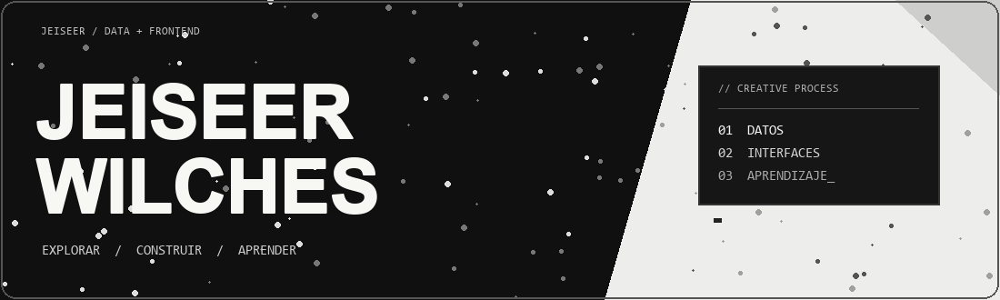
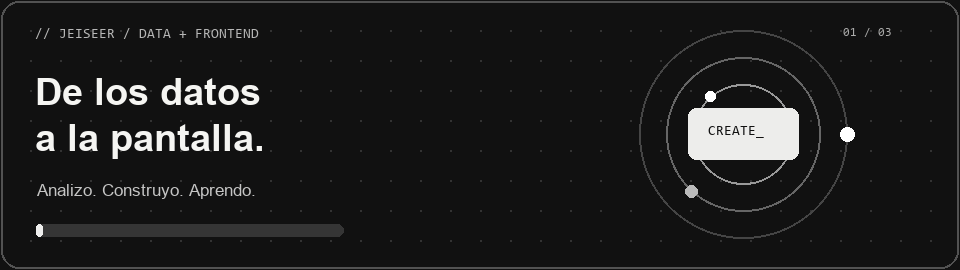
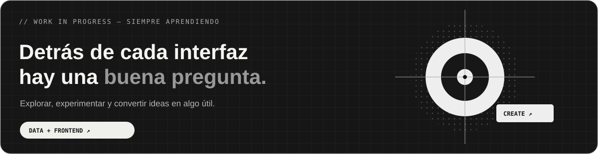

 

Soy aprendiz del **SENA**, actualmente en prácticas. Trabajo en proyectos donde puedo explorar información y participar en la creación de interfaces: dos formas distintas de acercar las ideas a las personas.

📊 Con **Python y Power BI**, exploro datos y busco maneras claras de presentarlos.  
💻 Desde el **frontend**, colaboro en la construcción de experiencias web.  
🔍 También estoy fortaleciendo mis bases de **SQL y backend**, aprendiendo junto a mi equipo.

> Me interesa entender el problema antes de construir la solución.

 

  

 

## ● &nbsp; TRABAJO DESTACADO  / 01

**Cattleya** es un proyecto colaborativo del SENA que analiza datos sobre la violencia contra la mujer en Colombia. Mi aporte fue el **desarrollo del frontend**, como parte del trabajo en equipo.

↗ &nbsp; [**EXPLORAR PROYECTO**](https://github.com/EstebanJimenez2311/Cattleya) &nbsp; · &nbsp; `PROYECTO FINALIZADO`

 

## ● &nbsp; MI CAJA DE HERRAMIENTAS  / 02

 

## ● &nbsp; TRAYECTORIA  / 03

 

## ● &nbsp; UN PASO A LA VEZ  / 04

Cada contribución es parte del proceso. Aprendiendo Git y construyendo, un día a la vez.

 

JEISEER WILCHES &nbsp; / &nbsp; GRACIAS POR ESTAR AQUÍ

