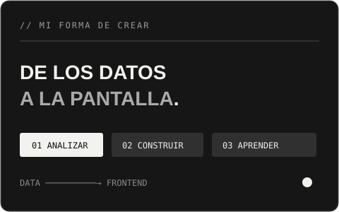

 

## `01 /` &nbsp; Del dato a la pantalla

<table>
<tr>
<td width="57%" valign="top">

**Exploro la información. Construyo la interfaz. Aprendo en el proceso.**

Soy Jeiseer, aprendiz del SENA en etapa de prácticas. Participo en proyectos de **frontend y análisis de datos**, con curiosidad por entender también lo que ocurre detrás de la pantalla.

Me gusta trabajar en equipo, convertir información en algo comprensible y construir interfaces que acerquen las ideas a las personas.

</td>
<td width="43%">

</td>
</tr>
</table>

## `02 /` &nbsp; Mi forma de trabajar

| **01 — EXPLORAR** | **02 — CONSTRUIR** | **03 — MEJORAR** |
| :--- | :--- | :--- |
| Analizo, limpio y visualizo datos con Python y Power BI. | Participo en la creación de interfaces web y en proyectos de frontend. | Aprendo en equipo y fortalezco mis bases de SQL y backend. |

## `03 /` &nbsp; Proyecto destacado

### 🌸 Cattleya &nbsp; `SENA / FINALIZADO`

Un proyecto colaborativo de análisis de datos sobre la **violencia contra la mujer en Colombia**. Una oportunidad para acercar una problemática social a las personas a través de la tecnología y la información.

**Mi participación:** desarrollé el frontend del proyecto, como parte del trabajo en equipo.

[**↗ Explorar Cattleya**](https://github.com/EstebanJimenez2311/Cattleya)

---

### En construcción &nbsp; `PROYECTOS COLABORATIVOS`

Actualmente participo en **Prizma Studio, DOCenter, Auto Prizma Pro** y [**Cargue automático Prizma**](https://github.com/AutoPrizma/cargue-autom-tico-prizma.site-). Mi enfoque en estos proyectos combina frontend, análisis de datos y colaboración con el equipo.

## `04 /` &nbsp; Herramientas

<table>
<tr>
<td width="50%" valign="top">

**DATOS / VISUALIZACIÓN**

</td>
<td width="50%" valign="top">

**FRONTEND / COLABORACIÓN**

</td>
</tr>
</table>

## `05 /` &nbsp; Formación y logros

🎓 **SENA** — Formación en programación para analítica de datos; actualmente en etapa de prácticas.

🏆 **Mejor aprendiz del segundo trimestre** — Reconocimiento por desempeño académico y compromiso.

## `06 /` &nbsp; Actividad

 

**DATOS → INTERFAZ → APRENDIZAJE**

Gracias por pasar por aquí. / Jeiseer Wilches

