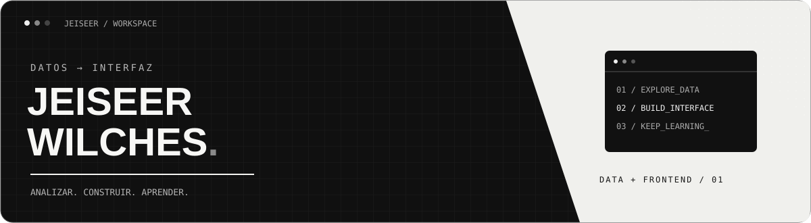
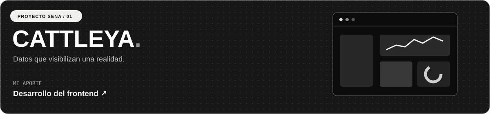
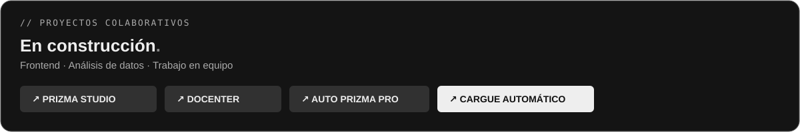
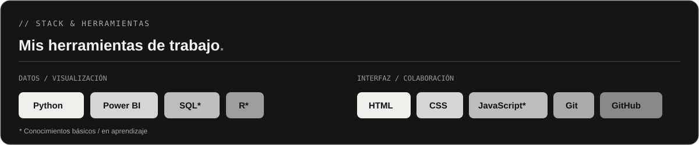
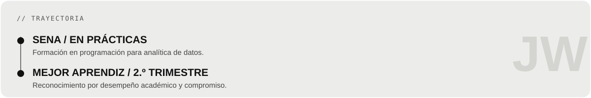

 

## ◼ &nbsp; EL PUNTO DE ENCUENTRO

**Soy Jeiseer Wilches. Me interesa lo que pasa entre una idea, los datos que la sustentan y la interfaz que la hace visible.**

Soy aprendiz del SENA en etapa de prácticas. Participo en proyectos de **frontend y análisis de datos**; también estoy fortaleciendo mis conocimientos de backend. Me gusta aprender junto a otros y convertir información en algo que las personas puedan entender y utilizar.

 

  

## ◼ &nbsp; TRABAJO DESTACADO  / 01

**Cattleya** es un proyecto colaborativo del SENA que analiza datos sobre la violencia contra la mujer en Colombia. Mi aporte fue el **desarrollo del frontend**, como parte del trabajo en equipo.

↗ &nbsp; [**EXPLORAR PROYECTO**](https://github.com/EstebanJimenez2311/Cattleya) &nbsp; · &nbsp; `PROYECTO FINALIZADO`

 

## ◼ &nbsp; EN CONSTRUCCIÓN  / 02

Participo en estos proyectos principalmente en frontend y análisis de datos. [**Ver Cargue automático Prizma ↗**](https://github.com/AutoPrizma/cargue-autom-tico-prizma.site-)

 

## ◼ &nbsp; MI CAJA DE HERRAMIENTAS  / 03

 

## ◼ &nbsp; TRAYECTORIA  / 04

 

JEISEER WILCHES &nbsp; / &nbsp; GRACIAS POR ESTAR AQUÍ

