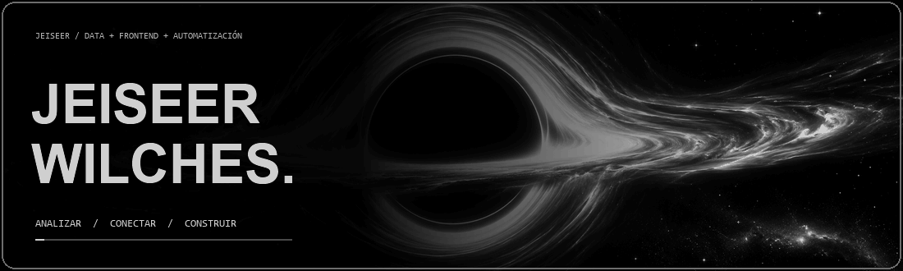
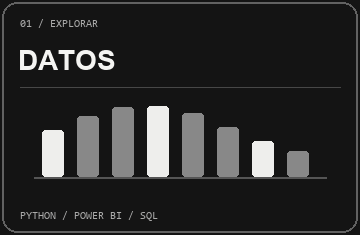
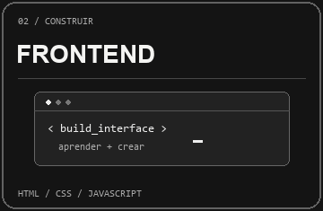
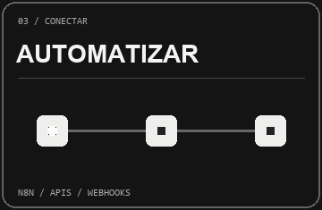

  

 

## ● &nbsp; MI UNIVERSO DIGITAL

Soy aprendiz del **SENA**, actualmente en prácticas. Me gusta entender los problemas, trabajar en equipo y convertir ideas en soluciones útiles. Sigo fortaleciendo mis bases de **SQL y backend** mientras aprendo con cada proyecto.

 

## ● &nbsp; TRABAJO DESTACADO  / 01

**Cattleya** es un proyecto colaborativo del SENA que analiza datos sobre la violencia contra la mujer en Colombia. Mi aporte fue el **desarrollo del frontend**, como parte del trabajo en equipo.

↗ &nbsp; [**EXPLORAR PROYECTO**](https://github.com/EstebanJimenez2311/Cattleya) &nbsp; · &nbsp; `PROYECTO FINALIZADO`

 

## ● &nbsp; MI CAJA DE HERRAMIENTAS  / 02

**TAMBIÉN ESTOY EXPLORANDO / AUTOMATIZACIÓN E INTEGRACIÓN**

He practicado con formularios, conexiones entre aplicaciones y flujos para tareas repetitivas, organización y validación de información.

 

## ● &nbsp; TRAYECTORIA  / 03

 

## ● &nbsp; MI CAMINO EN CÓDIGO  / 04

Estoy aprendiendo Git y GitHub. Cada contribución es un paso más en mi camino.

 

Gracias por acompañarme en el proceso. 🤍

